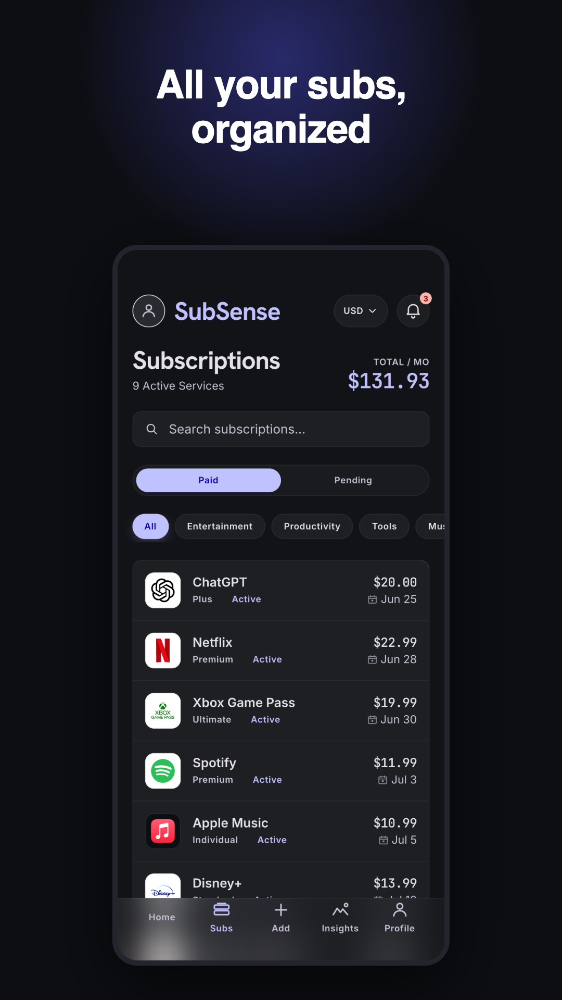
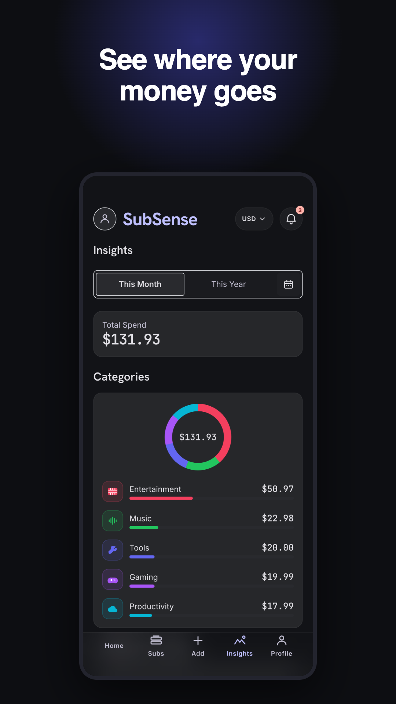
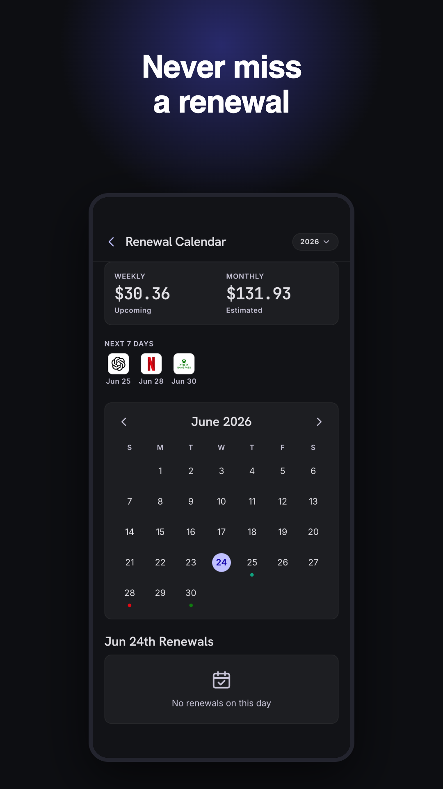

<div align="center">


<p>
  <a href="https://sub-sense-ashy.vercel.app"></a>
  
  
  
</p>

<p><em>One dashboard for every subscription: renewals, real spend and price hikes, caught in time.<br>
This repository is the public showcase of the Android app; its source code is kept private.</em></p>


</div>


## What it is

SubSense is a bilingual subscription tracker for Android. It shows what you really spend each month, reminds you before every renewal and points out services that overlap. It is free, has no ads, needs no account and keeps your data on the phone unless you choose to sync.

> **Why a showcase?** The Android app's code lives in a private repository. This one holds the exact Google Play assets so the app can be shown, linked and reviewed without opening the source. The same idea also runs on the web and on the Mac from the public [SubSense](https://github.com/kutluhangil/SubSense) monorepo.


## The store screens

<table>
  <tr>
    <td width="20%"></td>
    <td width="20%"></td>
    <td width="20%"></td>
    <td width="20%"></td>
    <td width="20%"></td>
  </tr>
  <tr>
    <td align="center"><sub>Every subscription,<br>in one place</sub></td>
    <td align="center"><sub>All your subs,<br>organized</sub></td>
    <td align="center"><sub>See where your<br>money goes</sub></td>
    <td align="center"><sub>Never miss<br>a renewal</sub></td>
    <td align="center"><sub>Private. Offline.<br>Free forever.</sub></td>
  </tr>
</table>

| Screen | What it shows |
|---|---|
| **Home** | Total monthly spend, active count, projected yearly cost, a budget alert and an insight about overlapping music services. |
| **Subscriptions** | The full list with search, category chips and each plan's next charge. |
| **Insights** | This month or this year, total spend and a category ring with per-category amounts. |
| **Renewal calendar** | A month grid with every renewal marked, and the cards for the selected day. |
| **Explore** | Service profiles with prices, to add a plan in two taps. |


## Highlights

| | |
|---|---|
| **Real monthly spend** | Monthly and yearly totals in your currency, with per-category budget alerts. |
| **Renewal reminders** | Notifications scheduled on the phone before every charge. No server. |
| **Price watch** | A plan whose price went up is flagged, measured on its US dollar price so exchange rates are not mistaken for hikes. |
| **On-device assistant** | Ask about spending, renewals, trials or overlaps in Turkish or English. Rule-based, no AI model, nothing leaves the phone. |
| **Calendar** | Every renewal on a month grid. |
| **Insights** | Category breakdowns, overlapping services and CSV export. |
| **Explore** | 42 service profiles with Turkish and global prices. |
| **App lock and widget** | Optional fingerprint unlock and a home-screen widget with the month's total. |
| **Private by default** | Works offline without an account; Google sync is optional and limited to your own data. |


## What is in this repository

```
play-assets/
  play-icon-512.png       store icon
  feature-graphic.png     1024 × 500 feature graphic
  store-01 … store-05.png the five phone screenshots, in store order
docs/media/               README banner, divider and signature
```


## Türkçe özet

**SubSense**, aboneliklerini kolayca takip etmeni sağlayan, Türkçe ve İngilizce destekli, ücretsiz, reklamsız ve hesap gerektirmeyen bir Android abonelik uygulaması. Verilerin yalnızca telefonda saklanıyor; istersen Google ile eşitleme açabiliyorsun. Gerçek aylık harcamayı, yaklaşan yenilemeleri, zamları ve çakışan servisleri gösteriyor; cihaz üzerinde çalışan bir asistan sorularını yanıtlıyor. Bu depo uygulamanın vitrini: Google Play görselleri burada, kaynak kod gizli bir depoda.

<div align="center">
<br>
<a href="https://github.com/kutluhangil"></a>
<sub>Showcase only · store listing text in the banner is paraphrased.</sub>
</div>
