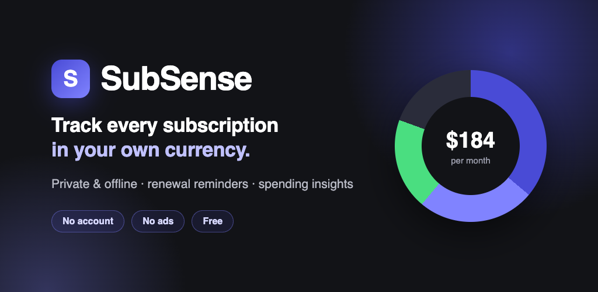
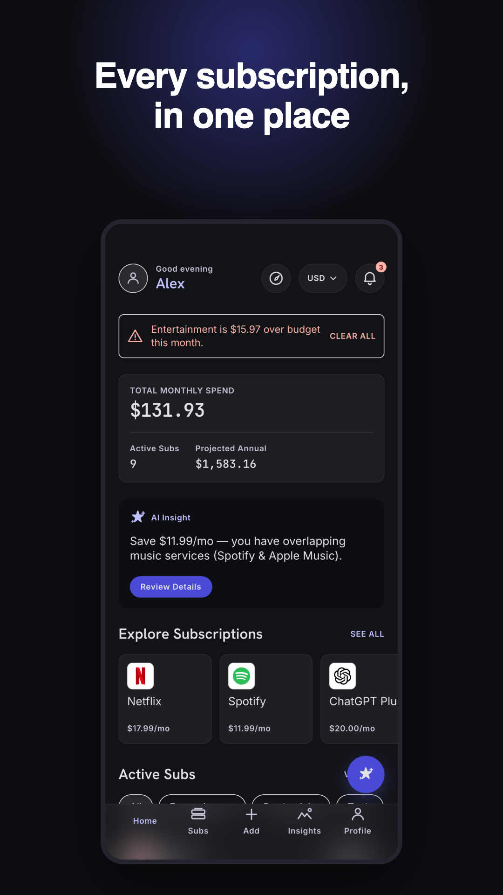
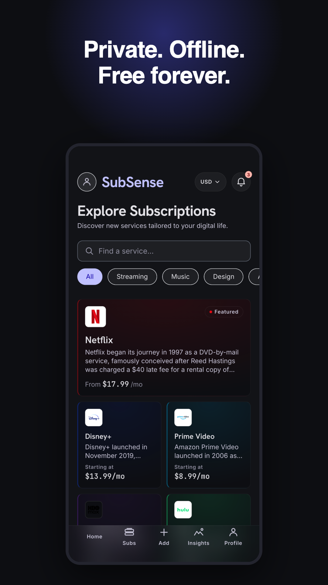

  
  
  
  

<em>One dashboard for every subscription: renewals, real spend and price hikes, caught in time. 
This repository is the public showcase; the source code is kept private.</em>

<table>
  <tr>
    <td width="20%"></td>
    <td width="20%"></td>
    <td width="20%"></td>
    <td width="20%"></td>
    <td width="20%"></td>
  </tr>
</table>

## What it is

SubSense is a bilingual subscription tracker. It shows what you really spend each month, reminds you before every renewal and points out services that overlap. It is free, needs no account, and keeps your data on your device unless you choose to sync.

## Highlights

| | |
|---|---|
| **Real monthly spend** | Monthly and yearly totals with budget alerts. |
| **Renewal reminders** | Local notifications before every charge. |
| **Calendar** | Every renewal on a month grid. |
| **Insights** | Category breakdowns and overlapping services. |
| **Explore** | Profiles and prices for popular services. |
| **Private by default** | Works offline without an account; Google sync is optional. |

## Türkçe özet

**SubSense**, aboneliklerini kolayca takip etmeni sağlayan, Türkçe ve İngilizce destekli, ücretsiz ve hesap gerektirmeyen bir abonelik yönetim uygulaması. Verilerin yalnızca cihazında saklanıyor; istersen Google ile eşitleme açabiliyorsun. Gerçek aylık harcamayı, yaklaşan yenilemeleri ve gereksiz çakışan servisleri gösteriyor. Bu depo uygulamanın vitrinidir; kaynak kod gizli.

 

Showcase only · web, Mac and Android from one codebase.

